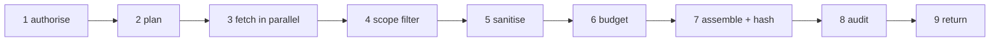

# Design

proba-context builds the context the brain reasons over: one bounded, auditable **context packet** per step.

Given a `ContextRequest` (trace, workspace, user, goal, thread, step, step type, optional typed needs and budget), it returns a `ContextPacket`: sections of citable items, the gaps that could not be filled, and a manifest of what each source returned, kept and dropped. Both types come from `@smallseedlabs/proba-protocol` (v0.4.0).

Guarantees:

- **Scoped.** Everything is built for the authenticated identity. An item that belongs to another workspace or user never reaches a packet.
- **Bounded.** The packet fits the token budget (never above `budget.maxTokens`). Policy, task and tools are never dropped for space; if they alone do not fit, the build fails with a clear error rather than returning half a policy.
- **Clean.** Secrets are always redacted from item text and data; personal data is redacted when `redaction.pii` is on. Every item carries a trust label; text from a user or an outside source is never labelled `system`.
- **Auditable.** Every build writes `context.*` audit events with ids and counts. Item text never appears in an audit event or an error message.
- **Deterministic.** The same inputs (including the same clock and ids) give the same packet and the same `packetHash`, whatever order the sources return items in.

## Architecture

| Package | Contents |
|---------|----------|
| `packages/core` | Ports, config schema and loader, templates, redaction, the build pipeline (`buildContext`), `packetHash`. No network I/O. |
| `packages/adapters` | Config-file policy and tool catalog, approximate tokenizer, system clock, Redis stream audit emitter, local identity resolver, in-process sources, Phase-2 HTTP clients for memory / audit / analytics (service JWT, `X-Act-As`, retries, circuit breaker, SSRF allow-list). |
| `apps/context-api` | Fastify HTTP surface and the wiring (`runtime.ts`). |

The core depends only on ports. Fakes for the sources live in `packages/core/src/pipeline/__fixtures__/` and in test files; they are excluded from the build and not exported.

## Pipeline

`buildContext(deps, request, identity)` in `packages/core/src/pipeline/`.

1. **Authorise.** The identity is already resolved (see Identity). The request's `workspaceId`, `userId`, `goalId` and `threadId` must equal the identity's, otherwise the build fails with `identity_mismatch` (HTTP 403) and `context.build_failed` with outcome `denied`. Audit events use the identity's ids, never the body's.
2. **Plan.** The template for the step type (highest `<stepType>.v<N>.yaml`) lists the sections. Typed needs are merged in. A need becomes a gap and never reaches a source when:
   - policy forbids that kind for the step (`restrictedNeeds` in `policy.yaml`) or its source is switched off: `need_refused_by_policy`;
   - it is beyond `limits.maxNeedsPerRequest`, or asks for more than `limits.maxItemsPerSource` items: `need_out_of_limits`.

   An allowed need for a section the template lacks adds that section as optional (and only the need's call is made, not the section's base fetch). Each refusal emits `context.need_refused`.
3. **Fetch.** Every source call runs in parallel, each under its source's `timeoutMs` (an `AbortSignal` is passed to the source). A call that fails or times out yields no items and a gap: `source_timeout`, or `<source>_unavailable` (`conversation_unavailable`, `memory_unavailable`, `audit_history_unavailable`, `analytics_unavailable`, `tools_unavailable`, `task_unavailable`). **A failure of `policy` or `task` when the template requires it fails the build** (`required_source_failed`, HTTP 502), as does a template-required `policy` or `task` source that is switched off. Items that are not valid `ContextItem`s are dropped (`invalid_item`). One `context.source_fetched` event is written per call.
4. **Scope.** The second line of defence after sources are queried with the identity: an item whose `data.workspaceId` or `data.userId` is present and differs from the identity's (or is not a string) is dropped, counted as `scope_violation`, and one `context.scope_violation` event (outcome `denied`) is written per source. The manifest does not list the ids of such items. Tool items must carry `data.name`, and a tool that policy restricts for the step is dropped (`policy_forbidden_tool`), so a forbidden tool cannot reach a packet even if the catalog source returns it.
5. **Sanitise.** Text and every string inside `data` are redacted (see Redaction); string values under id-like keys (`userId`, `*_id`, ...) only lose secrets so that ids are not mangled. Text is cut at `limits.maxItemChars`. Trust is clamped to the section's ceiling: `policy`, `task`, `tools` may be `system`; `conversation` at most `user`; `memory`, `audit_history`, `analytics` at most `derived`. A source can lower trust (down to `external`) but never raise it. The source's own objects are copied, not changed.
6. **Budget** (below).
7. **Assemble.** Sections are ordered by tier, then configured priority; empty sections are omitted. Conversation items read in time order, other sections in rank order. The packet is hashed with `computePacketHash` over everything except `packetHash`.
8. **Audit.** `context.requested` first, then (in this order) `context.need_refused`, `context.source_fetched` per call, `context.scope_violation`, `context.gap_detected` per gap, and finally `context.built` (outcome `success`, `packetId`, `packetHash` and counts) or `context.build_failed` (outcome `failure` or `denied`, `errorCode`). Details are limited to ids, source and need kinds, gap codes and counts. If an event cannot be written the build fails with `audit_unavailable` (HTTP 503): nothing is returned without its audit record.
9. **Return** the `ContextPacket`.

### Budgeting

Budget = `min(request.budgetTokens ?? budget.defaultTokens, budget.maxTokens)`. An item costs the tokens of its canonical JSON (what the packet carries), counted by the `Tokenizer`. A section's `tokens` is the sum of its items; `manifest.totals.tokens` is the sum of the sections. Gaps and the manifest are not counted: they are small and bounded by the number of sources.

Tiers: **P0** is policy, task and tools. The others follow `budget.priorities` and are numbered 1, 2, 3, 4 (conversation, memory, audit history, analytics with the shipped config). The section `priority` in the packet is its tier.

Within a tier items rank by `score` (higher first; missing counts as 0), then `observedAt` (newer first), then `itemId`. Then:

1. duplicates by `sourceRef` (`source` + `id`) are dropped, the better-ranked copy stays (`duplicate`);
2. each section is cut at its item limit (`section_limit`: the template's `maxItems`, at most `limits.maxItemsPerSource`) and, except P0, at its token share of the budget (`source_share`: `tokenShare`);
3. if P0 alone is larger than the budget the build fails with `budget_exceeded_by_required` (HTTP 422);
4. otherwise items are trimmed from the bottom of the ranking (analytics first, conversation last) until the packet fits (`budget`).

P0 is never dropped by steps 2 and 4. The result depends only on the items and the config, not on the order the sources returned them in.

Every dropped item is counted per source in `manifest.sources.<kind>.droppedReasons` and, except scope violations and invalid items, listed in `manifest.droppedItemIds` (sorted).

### Gaps

| Code | When |
|------|------|
| `no_analytics_for_campaign` | The analytics section is planned and no usable item came back (with a `suggestedQuestion`). |
| `need_refused_by_policy`, `need_out_of_limits` | A need was refused in the plan step. |
| `source_timeout` | A source did not answer in time. |
| `source_error` | A source returned a response that failed schema / contract validation (or another adapter-signalled error). |
| `<source>_unavailable` | A source failed without a more specific gap code. |

Empty sources other than analytics are not gaps: no memory is a normal state. Gap reasons are generic text; they never include text from a source or from an error.

### Manifest

`manifest.sources` has an entry for each of the seven section kinds: `requested` (planned and enabled), `returned` (raw count), `included`, `dropped` (`returned - included`), `droppedReasons`, `cacheHit` (always `false`, the cache is off), `latencyMs` (slowest call of that source), `tokens`. `totals` sums them, plus `gaps` and the build's `latencyMs`. Latencies come from the injected `Clock`, so they are zero with a fixed clock.

## Redaction

`packages/core/src/redaction/`. Ported from proba-memory's write path. Secrets, always: private keys, JWTs, AWS keys, GitHub and Slack tokens, `sk-`/`pk-` keys, Google keys, bearer tokens, credentials in URLs, `password=`/`token=`/`api_key=` assignments. Personal data when `redaction.pii` is true (the default): email, card numbers (Luhn-checked), IBAN (checksum-checked), SSN, phone numbers. Replacement is `[REDACTED:<type>]`; redaction is idempotent. One difference from proba-memory: the token patterns with a distinctive prefix (GitHub, AWS, Slack, Google, JWT) also match when glued to a preceding word character, found by a property test.

## Identity

`IdentityResolver` turns credentials into a `ResolvedIdentity` (`workspaceId`, `userId`, `goalId`, `threadId`, `scopes`).

- **`act_as_assertion`** (default): verify the Hub act-as JWT (`Authorization: Bearer` or `X-Act-As`), claim its `jti`, call Hub `POST /v1/internal/authorize`. See [SCOPING](SCOPING.md).
- **`firebase_passthrough`**: verify a Firebase ID token; scope from the request body. Disabled unless configured.
- **Local identity** (`LocalIdentityResolver`): `Authorization: Bearer local:<userId>:<workspaceId>:<goalId>:<threadId>` or `X-Local-Identity: {"userId":..,"workspaceId":..,"goalId":..,"threadId":..}`. No verification. Allowed only when `NODE_ENV!=production` **and** `identity.allowLocal` / `CONTEXT_ALLOW_LOCAL_IDENTITY`. Production always refuses it.
- **Admin routes** (`GET /v1/context/packets*`): Firebase + allow-list (admin/viewer). Viewers get 403; admins see the manifest only.

## Adapters wired by `context-api`

| Section | Adapter | Notes |
|---------|---------|-------|
| policy | `ConfigPolicySource` | `config/policy.yaml`, statements filtered by `appliesTo` |
| tools | `ConfigToolCatalogSource` | `config/tools.yaml` filtered by `appliesTo`, minus `restrictedTools` for the step |
| task | `TaskStateHttpSource` when `HUB_BASE_URL` + key are set; else `IdentityTaskSource` | Hub `GET /v1/internal/goals/{goalId}/state` |
| conversation | `ConversationHttpSource` when `HUB_BASE_URL` + key are set; else empty | Hub `GET /v1/internal/threads/{threadId}/messages` |
| memory | `MemoryHttpSource` when env URLs + key are set; else empty | `POST /v1/memories/search`, `GET /v1/profiles` |
| audit_history | `AuditHttpSource` when env URLs + key are set; else empty | `GET /v1/events`, `GET /v1/traces/{id}` |
| analytics | `AnalyticsHttpSource` (same audit base URL); else empty | `GET /v1/analytics/campaigns`, `/summary`, `/compare` |
| tokenizer | `ApproximateTokenizer` | one token per four characters, rounded up |
| clock | `SystemClock` | |
| audit | `RedisStreamAuditEmitter` | `XADD proba.audit.events * data=<AuditEvent JSON> publishedAt=<UTC ISO> key=<workspaceId>`; each event is validated against the protocol schema first |

Audit sink selection (`runtime.ts`): with `REDIS_URL` set (host must be in `allowedDownstreamHosts`) events go to the stream (`AUDIT_STREAM`, default `proba.audit.events`; `AUDIT_STREAM_MAXLEN` for approximate trimming). Without it, outside production, a `LogAuditEmitter` prints one line per event (ids, action, outcome only); in production the process refuses to start. A Redis outage fails builds with 503 rather than skipping audit.

## HTTP API

| Method and path | Purpose |
|-----------------|---------|
| `GET /health` | Liveness. |
| `POST /v1/context/build` | Body: `ContextRequest` (validated with the protocol's zod schema). 200 with a `ContextPacket`. |
| `GET /v1/context/needs?stepType=` | Need kinds the brain may ask for in that step: the protocol's four kinds minus `restrictedNeeds` and minus kinds whose source is disabled. |
| `GET /v1/context/packets?goalId=` | Admin (Firebase): paginated packet manifests for a goal. Viewers get 403. |
| `GET /v1/context/packets/{packetId}` | Admin (Firebase): one packet's manifest only. Viewers get 403. |

Both `/v1/context` routes resolve the identity first. Errors are `{ "error": { "code", "message" } }` (400 also carries `issues` with paths and messages, no values):

| Status | Code | Cause |
|--------|------|-------|
| 400 | `invalid_request` | Body or `stepType` invalid |
| 401 | `identity_missing`, `identity_invalid` | No or malformed credentials |
| 403 | `identity_mismatch` | Body names another workspace, user, goal or thread |
| 413 | | Body over `limits.maxRequestBytes` |
| 422 | `budget_exceeded_by_required`, `template_missing` | Policy, task and tools do not fit; no template for the step |
| 502 | `required_source_failed` | Policy or task could not be read |
| 503 | `audit_unavailable`, `identity_unconfigured` | Audit stream down; production without identity verification |
| 500 | `internal_error` | Anything else; the message is generic |

## Ports

`ConversationSource`, `TaskStateSource`, `MemorySource`, `AuditHistorySource`, `AnalyticsSource` (with `overview` for the goal-level read and `compare` for the `analytics_compare` need), `PolicySource`, `ToolCatalogSource`, `PolicyGuard`, `ContextCache`, `Tokenizer`, `AuditEmitter`, `Clock`, `IdentityResolver`. `PolicyGuard` carries the two rules the pipeline enforces itself: which needs are allowed for a step, and which tools are never allowed for a step.

## Packet hash

`computePacketHash` is SHA-256 (hex) of canonical JSON: keys sorted recursively, `undefined` omitted, no whitespace, array order kept. The packet's `packetId` and manifest are inside the hash, so two builds hash alike only with the same ids and clock.

## Phases

| Phase | Scope |
|-------|-------|
| 0 | Scaffold: monorepo, ports, config, templates, hash, health endpoint, CI, container |
| 1 | Pipeline, redaction, budgeting, scope filter, config-file policy and tools, Redis stream audit, local identity, `POST /v1/context/build` |
| 2 | HTTP sources for memory, audit history and analytics; Hub conversation/task still empty until brief 05 merges |
| 3 | Act-as assertion verification, Hub authorize, admin Firebase packet routes, rate limits, jti replay store |

## Open questions

- Act-as assertion scopes and the sections each grants (see [SCOPING](SCOPING.md)).
- Whether a failed `tools` source should also fail the build; today it becomes a `tools_unavailable` gap and the brain simply has no tools in that step.
- A real tokenizer for the model in use; the approximation can be off by a wide margin for non-English text.
