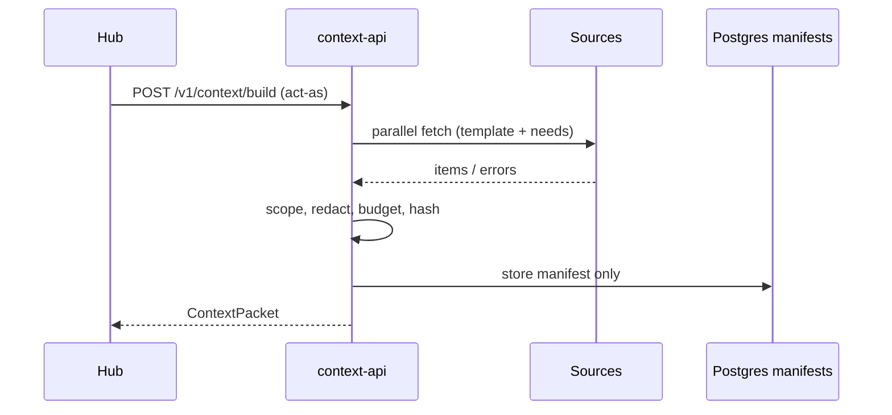

# Walkthroughs (one flow per step type)

Each flow is what the Hub sends before that brain step, what sources return, what is dropped, which gaps appear, and which audit events are written. Deep dive for budget changes: [WALKTHROUGH_RAISE_BUDGET.md](WALKTHROUGH_RAISE_BUDGET.md). Templates live in `config/templates/<stepType>.v1.yaml`.

Shared audit spine for every successful build:

1. `context.requested`
2. one `context.source_fetched` per attempted source (plus `context.cache_hit` / `context.cache_miss` when caching is on)
3. `context.gap_detected` when a gap is recorded
4. `context.item_dropped` when budget or scope drops items
5. `context.built` (or `context.build_failed`)

Admin later: `context.packet_viewed` on manifest reads.

---

## 1. `interpret_message`

**Hub sends:** `ContextRequest` with `stepType: interpret_message`, new user message on the thread, goal/thread ids from the command.

**Sources:** policy (required), tools (required), task (required), conversation (recent turns), memory (light profile).

**Dropped / gaps:** analytics and audit history are usually absent from the template — not gaps. Empty memory → optional gap per template. Out-of-scope items → dropped + `context.scope_violation`.

**Audit:** spine above; no `need_*` unless the brain continues with hybrid needs.

---

## 2. `clarify`

**Hub sends:** same goal/thread after the brain chose to ask a clarifying question; `stepType: clarify`.

**Sources:** policy, tools, task, conversation (including the clarify prompt context), memory.

**Dropped / gaps:** keep policy/tools/task whole; trim conversation first under a tight budget. Memory miss is non-fatal.

**Audit:** spine; optional `context.need_requested` if the brain asked for `conversation_before`.

---

## 3. `plan_goal`

**Hub sends:** after the user accepted a goal; `stepType: plan_goal`.

**Sources:** policy, tools, task (goal status/budget), conversation, memory (planning tags), audit history for the goal (`goal.*`).

**Dropped / gaps:** `no_analytics_for_campaign` if analytics is in the template and empty; otherwise analytics omitted. Budget trims audit_history before conversation when priorities say so.

**Audit:** spine including `context.source_fetched` for audit_history.

---

## 4. `propose_budget`

**Hub sends:** plan needs a budget; see [WALKTHROUGH_RAISE_BUDGET.md](WALKTHROUGH_RAISE_BUDGET.md).

**Sources:** policy, tools, task, conversation, memory (budget), audit_history (goal/budget events), analytics (campaign spend).

**Dropped / gaps:** `no_analytics_for_campaign` when analytics empty; redaction of emails/secrets in conversation; audit trimmed under budget.

**Hybrid:** brain may ask `analytics_compare`; windows outside policy → `context.need_refused` + gap.

**Audit:** spine + gap + optional need events.

---

## 5. `handle_approval`

**Hub sends:** user approved or declined a budget/card; `stepType: handle_approval`.

**Sources:** policy, tools, task (approval state), conversation, audit_history (budget/approval actions).

**Dropped / gaps:** tools section lists only tools allowed for this step; restricted tools appear with reasons, never as allowed.

**Audit:** spine; task section must reflect Hub approval state.

---

## 6. `launch_campaign`

**Hub sends:** campaign ready to launch; `stepType: launch_campaign`.

**Sources:** policy, tools (launch-related), task, conversation, memory, audit_history.

**Dropped / gaps:** a tool forbidden for the step never appears as allowed. Memory/external text never enters policy/tools sections.

**Audit:** spine; tools section audited via manifest counts only.

---

## 7. `review_performance`

**Hub sends:** analytics arrived or scheduled review; `stepType: review_performance`.

**Sources:** policy, tools, task, audit_history, analytics (spend/results), memory, conversation.

**Dropped / gaps:** before analytics exist → `no_analytics_for_campaign`; after stub/ingester/rollup → analytics section populated. Cross-goal analytics dropped by scope filter.

**Audit:** spine; gap before analytics, no that gap after.

---

## 8. `explain_decision`

**Hub sends:** user asks why (e.g. pause); `stepType: explain_decision`.

**Sources:** policy, tools, task, audit_history / optional `audit_trace` need, conversation, memory, analytics if present.

**Dropped / gaps:** need `audit_trace` served when in policy; refused needs → gap. Max need rounds enforced (`needs.maxRoundsPerStep`).

**Audit:** spine + `context.need_requested` / `context.need_refused` as applicable.

---

## Sequence (generic)

