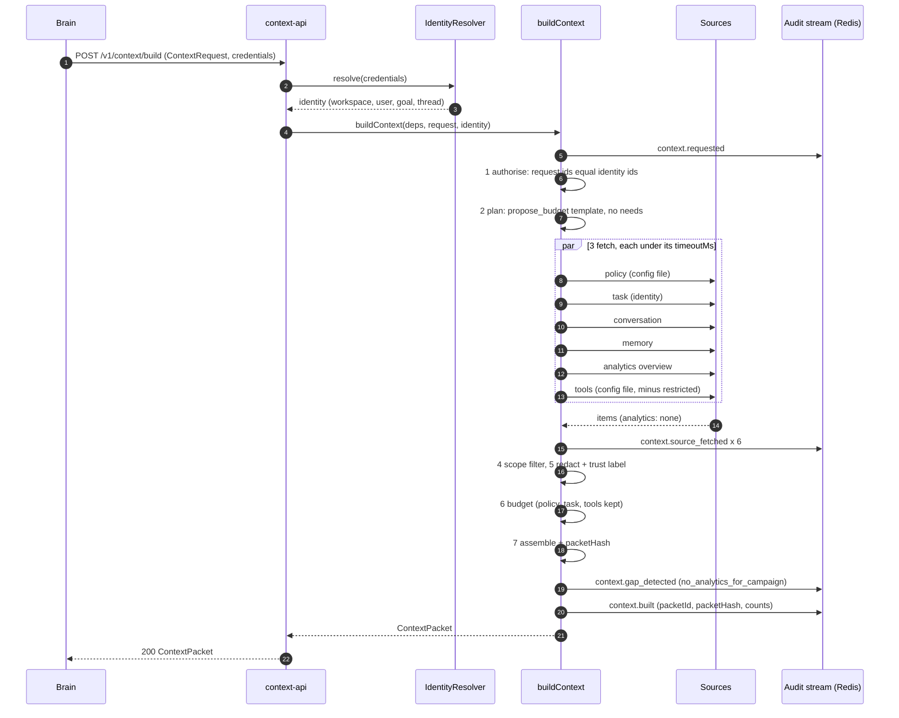

# Walkthrough: "raise the budget"

A user tells the brain: *"Raise the budget to 150 a day. Send the receipt to jane.doe@example.com."* The brain is in the `propose_budget` step. This page follows the request through proba-context. The same flow is asserted by `packages/core/src/pipeline/walkthrough.test.ts` and, over HTTP, by `apps/context-api/src/app.test.ts`.

## 1. The sequence



## 2. The request

```json
{
  "traceId": "550e8400-e29b-41d4-a716-446655440000",
  "workspaceId": "seedbed",
  "userId": "660e8400-e29b-41d4-a716-446655440001",
  "goalId": "770e8400-e29b-41d4-a716-446655440002",
  "threadId": "880e8400-e29b-41d4-a716-446655440003",
  "stepId": "step-propose-budget-1",
  "stepType": "propose_budget"
}
```

On a workstation the caller identifies itself with
`Authorization: Bearer local:<userId>:<workspaceId>:<goalId>:<threadId>` (see [DESIGN](DESIGN.md#identity); refused in production).

## 3. What comes back

- **Sections.** `policy` (the spend-approval statement from `config/policy.yaml`), `task`, `tools` (only `propose_budget`: `launch_campaign` is restricted for this step), and `conversation` when the thread source has turns. All carry a trust label; the conversation turn is `user`.
- **Redaction.** The turn reads `Raise the budget to 150 a day. Send the receipt to [REDACTED:email].` The address does not appear in the packet or in any audit event.
- **Gap.** The analytics source returned nothing for the goal, so the packet carries

  ```json
  {
    "code": "no_analytics_for_campaign",
    "source": "analytics",
    "reason": "No campaign metrics were returned for this goal.",
    "suggestedQuestion": "Which campaign should I look at?"
  }
  ```

  The brain can ask that question instead of inventing a number (the `no-invented-metrics` policy).
- **Manifest.** Per source: `requested`, `returned`, `included`, `dropped`, `droppedReasons`, `tokens`; totals with `gaps: 1`. `packetHash` is the SHA-256 of the packet without the hash.

## 4. Expected audit events

All events share the request's `traceId`; `context.requested` is the root span and the rest are its children. Details carry ids and counts only.

| # | `action` | `outcome` | Notable details |
|---|----------|-----------|-----------------|
| 1 | `context.requested` | success | `packetId`, `stepId`, `stepType`, `configVersion`, `counts.needs`, `counts.budgetTokens` |
| 2 | `context.source_fetched` | success | `source: policy`, `counts.returned` |
| 3 | `context.source_fetched` | success | `source: task` |
| 4 | `context.source_fetched` | success | `source: conversation` |
| 5 | `context.source_fetched` | success | `source: memory` |
| 6 | `context.source_fetched` | success | `source: analytics`, `counts.returned: 0` |
| 7 | `context.source_fetched` | success | `source: tools` |
| 8 | `context.gap_detected` | partial | `source: analytics`, `gapCode: no_analytics_for_campaign` |
| 9 | `context.built` | success | `packetHash`, `counts.{sections,items,dropped,tokens,gaps,redactions}` |

`source_fetched` events follow the order of the section kinds (policy, task, conversation, memory, audit_history, analytics, tools); `audit_history` is not in this step's template, so it has no event. The events go to the Redis stream `proba.audit.events` as `XADD ... data=<AuditEvent JSON> publishedAt=<ISO> key=seedbed`.

Variations:

- A source times out: its `context.source_fetched` has outcome `failure` and `errorCode: source_timeout`, and a `context.gap_detected` follows with `gapCode: source_timeout`. If it was `policy` or `task`, the build ends with `context.build_failed` instead of `context.built`.
- The brain asks for a need policy forbids (for example `audit_trace` in this step): `context.need_refused` (outcome `denied`) after `context.requested`, and a `need_refused_by_policy` gap.
- A source returns an item of another user: `context.scope_violation` (outcome `denied`) after the `source_fetched` events; the item is not in the packet.
- The budget cannot hold policy, task and tools: `context.build_failed` with `errorCode: budget_exceeded_by_required`.
- The identity and the body disagree: `context.requested`, then `context.build_failed` with outcome `denied` and `errorCode: identity_mismatch`; no source is called.

## 5. Try it

```bash
npm run build
NODE_ENV=development node apps/context-api/dist/index.js &   # audit events are printed, one line each

curl -s -X POST http://127.0.0.1:3500/v1/context/build \
  -H 'content-type: application/json' \
  -H 'authorization: Bearer local:660e8400-e29b-41d4-a716-446655440001:seedbed:770e8400-e29b-41d4-a716-446655440002:880e8400-e29b-41d4-a716-446655440003' \
  -d '{"traceId":"550e8400-e29b-41d4-a716-446655440000","workspaceId":"seedbed","userId":"660e8400-e29b-41d4-a716-446655440001","goalId":"770e8400-e29b-41d4-a716-446655440002","threadId":"880e8400-e29b-41d4-a716-446655440003","stepId":"step-1","stepType":"propose_budget"}'
```

With the in-process sources of this phase the conversation is empty, so the packet holds policy, task and tools and the analytics gap. To see events in Redis set `REDIS_URL` (see [RUNBOOK](RUNBOOK.md)).
